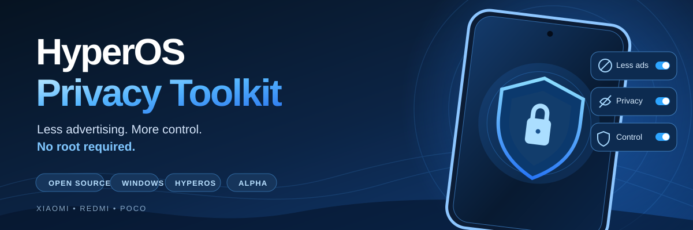

<div align="center">

   

**🛡️ Meno pubblicità · 🔐 Più controllo · 📱 Per Xiaomi / Redmi / POCO supportati**

[🇬🇧 English](README.md) · [🚀 Come si usa](#come-si-usa) · [📱 Compatibilità](#il-mio-telefono-è-compatibile) · [🛠️ Contribuisci](CONTRIBUTING.md)

</div>

---

# HyperOS Privacy Toolkit

**Meno pubblicità. Più controllo sul tuo Xiaomi, Redmi o POCO.**

Un progetto gratuito e open source per individuare e disattivare alcune raccomandazioni pubblicitarie e impostazioni facoltative di raccolta dati su HyperOS. Non richiede root né lo sblocco del bootloader.

> **Versione sperimentale.** Oggi è uno strumento per Windows a riga di comando, non ancora un'app con pulsanti. Un'interfaccia grafica semplice è il prossimo obiettivo.

## ✨ Cosa può fare davvero?

| Funzione | Stato |
|---|---|
| Disattivare i suggerimenti in Sicurezza | Testato |
| Disattivare i suggerimenti in Pulizia | Testato |
| Disattivare i contenuti consigliati in Download | Testato |
| Revocare l'autorizzazione pubblicitaria MSA | Testato; richiede una conferma aggiuntiva |
| Eliminare tutte le pubblicità in Gestione File | **Non dimostrato** |
| Bloccare tutta la telemetria Xiaomi | **Non dimostrato** |

Prima legge lo stato di un'impostazione, poi richiede il permesso per cambiarla e infine verifica il risultato. Alcune modifiche sono ripristinabili automaticamente; la riattivazione di MSA per ora è solo manuale.

## 📱 Il mio telefono è compatibile?

**Testato realmente:** POCO F5 (23049PCD8G, marble), Android 15, HyperOS OS3.0.4.0 globale, interfaccia italiana.

**Altri Xiaomi, Redmi e POCO:** per ora solo rilevamento. Il programma non tenta modifiche su modelli o versioni non verificati.

## 🚀 Come si usa?

Al momento servono un PC Windows e qualche passaggio tecnico. Se non hai dimestichezza con il terminale, **conviene aspettare la futura versione con interfaccia guidata**.

1. Installa [Python 3.11 o successivo](https://www.python.org/downloads/) e gli [Android Platform-Tools ufficiali](https://developer.android.com/tools/releases/platform-tools).
2. Abilita il debug USB o wireless autorizzato sul telefono e collegalo al PC.
3. Apri PowerShell nella cartella del progetto ed esegui:

```powershell
py -m venv .venv
.\.venv\Scripts\Activate.ps1
pip install -e .
hyperos-privacy doctor
hyperos-privacy analyze
```

Questi comandi verificano il collegamento e analizzano il telefono: **non modificano le impostazioni**.

Per applicare una modifica testata, il comando richiede una conferma esplicita:

```powershell
hyperos-privacy analyze --action security-recommendations
hyperos-privacy apply security-recommendations --confirm security-recommendations
```

Per MSA è prevista un'ulteriore conferma perché Xiaomi avverte che la revoca può comportare l'eliminazione dei dati associati sui suoi server. Non procedere se non hai letto l'avviso.

Il ripristino automatico è disponibile solo per determinate modifiche documentate nei log. Per MSA, usa **Impostazioni → Autorizzazioni e revoche → msa** per concedere nuovamente l'autorizzazione.

## ⚠️ Cosa non fa

Non cambia il sistema operativo, non disinstalla app, non promette prestazioni migliori e non garantisce l'eliminazione di tutti gli annunci o delle comunicazioni con Xiaomi. Gli annunci di Gestione File sono intermittenti: alcuni test senza annunci non equivalgono a una soluzione definitiva.

## 🛡️ Sicurezza e privacy

- Nessun root, reset, flash o rimozione di package.
- Nessuna modifica automatica su telefoni non supportati.
- Conferma esplicita prima di cambiare impostazioni.
- Screenshot e log locali non vengono pubblicati su GitHub.
- HyperOS può richiedere **Debug USB (impostazioni di sicurezza)** per consentire i tocchi automatici.

## 🧭 Prossimo obiettivo

Realizzare un **programma Windows con interfaccia semplice**: colleghi il telefono, vedi quali modifiche sono disponibili e decidi quali autorizzare, senza ricordare comandi.

Per approfondire: [configurazione ADB](docs/adb-setup.md), [compatibilità](docs/compatibility.md), [risultati tecnici](docs/technical-findings.md), [sicurezza](docs/safety-and-data-handling.md).

[English version](README.md) · [Licenza MIT](LICENSE)
